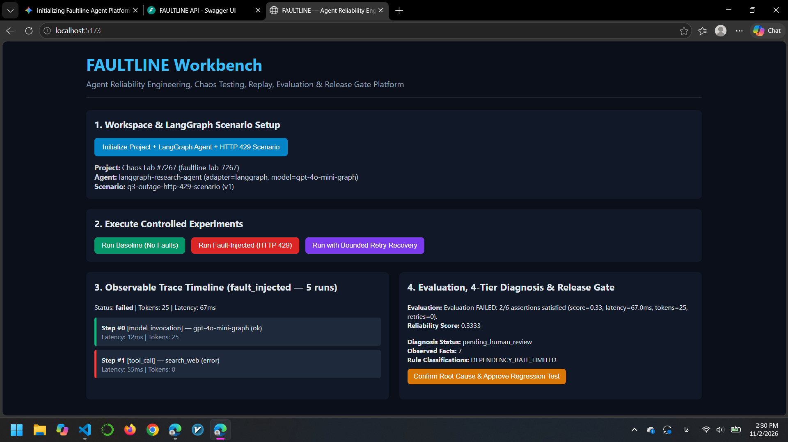
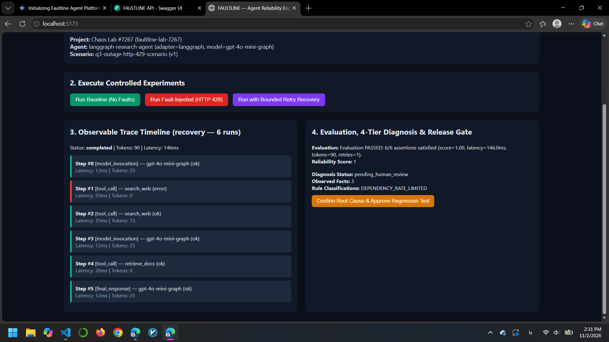
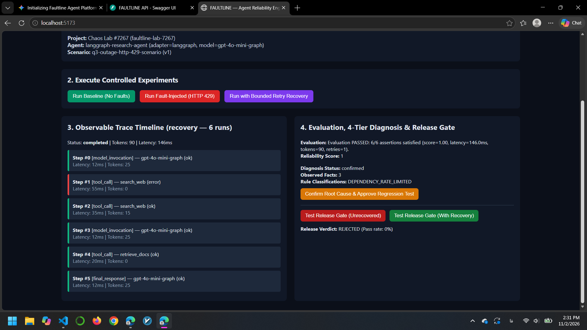
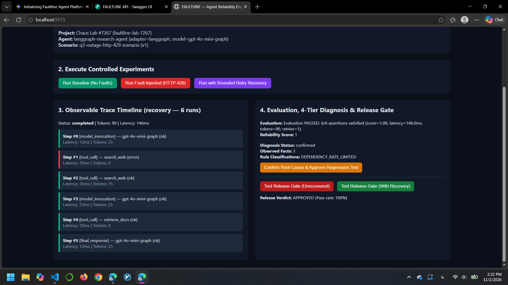

# FAULTLINE

**Agent Reliability Engineering, Chaos Testing, Replay, Evaluation & Recovery Platform**

[](#verification--test-suite)
[](#technology-stack)
[](#architecture)
[](#architecture)
[](#verification--test-suite)

Ordinary AI agent demos show what happens when every tool, API, and dependency works on the first try. **FAULTLINE** systematically investigates what happens when things go wrong.

FAULTLINE is a developer-facing reliability engineering workbench for connecting tool-using AI agents, defining versioned test scenarios, injecting deterministic faults (HTTP 429 rate limits, timeouts, malformed JSON, contradictory evidence), capturing observable execution traces, scoring true task satisfaction vs. superficial completion, experimenting with bounded recovery policies, replaying and diffing runs, diagnosing root causes with verifiable evidence, and enforcing automated release gates.

---

## Why FAULTLINE?

When an AI agent fails in production, engineering teams need answers grounded in evidence rather than guesswork:

1. **Controlled Fault Injection at the Tool Boundary:** Intercept agent tool calls deterministically on specific invocation counts (`trigger_on_call`) to inject `HTTP_429_RATE_LIMIT`, `TIMEOUT`, `MALFORMED_JSON`, `EMPTY_RESPONSE`, `CONTRADICTORY_DATA`, or `TOOL_UNAVAILABLE` without mutating agent code.

2. **True Satisfaction vs. Superficial Completion:** An agent that swallows a tool timeout and returns a generic fallback string may report `status="completed"`, but FAULTLINE's `EvaluationEngine` catches the failure against explicit scenario assertions (`required_substrings`, `forbidden_substrings`, `expected_tools`, `forbidden_tools`, latency/token budgets).

3. **Recovery Policy Trade-Off Analysis:** Retrying is not always free or effective. FAULTLINE tests bounded `retry`, `fallback_tool`, and `retry_then_fallback` policies while measuring the exact retry count, token overhead, and backoff latency added to the trace.

4. **Explicit Determinism Boundaries in Replay:** Clearly separates **Recorded Replay** (reconstructing captured trace paths or feeding recorded `ToolCallResult` queues to an updated agent version) from **Live Re-execution**, complete with step-by-step trace diffing (`StepDeviation`).

5. **Four-Tier Evidence-Based Failure Diagnosis:** Strictly separates **Observed Facts** (trace steps, errors, failed assertions), **Rule-Based Classifications**, **Unconfirmed Model Hypotheses** (`verification_status="unconfirmed_hypothesis"`), and **Human-Confirmed Root Causes**.

6. **Human-Gated Regression Suites & Release Gates:** Converts human-confirmed failures into regression test candidates, requires human approval before activating them, and blocks unstable agent releases when pass rate, reliability score, or latency thresholds are breached.

7. **Privacy & Security by Default:** Enforces `UPPER_SNAKE_CASE` environment variable secret references (rejecting raw API keys with HTTP 422) and recursively scrubs inline secrets (`sk-...`, `Bearer ...`), PII (emails, SSNs), and hidden Chain-of-Thought (`[REDACTED_COT]`) before database persistence.

---

## Workbench Walkthrough & Visual Evidence

### 1. Controlled Fault Injection & 4-Tier Failure Diagnosis
Injecting a deterministic `HTTP_429_RATE_LIMIT` fault into `search_web` causes the unrecovered LangGraph agent to fail (`score=0.33`), triggering automatic fact extraction and `DEPENDENCY_RATE_LIMITED` rule classification.


### 2. Bounded Retry Recovery & Trace Expansion
Executing the same scenario under a bounded `retry` recovery policy records both the initial failed tool call (`Step #1`) and the successful retry (`Step #2`), satisfying all 6 scenario assertions (`score=1.00`, `retries=1`).


### 3. Human-Confirmed Regression Suite & Release Gate Rejection
After human root-cause confirmation (`confirmed`), locking the failure into the regression suite automatically blocks the unrecovered agent release (`Release Verdict: REJECTED — Pass rate: 0%`).


### 4. Automated Release Gate Approval with Recovery Policy
Evaluating the release gate with the bounded retry recovery policy passes the regression suite and approves the release (`Release Verdict: APPROVED — Pass rate: 100%`).


---

## System Architecture

```text
Developer / React + TypeScript Workbench
        │
        ▼
FastAPI REST API (/api/v1)
        │
        ├──► Workspace & Scenarios (Projects, Versioned AgentConfigs, Versioned ScenarioDefinitions)
        │
        ├──► Execution Orchestrator (BaselineExecutionEngine)
        │        │
        │        ├──► AdapterRegistry ──► LangGraphResearchAdapter (StateGraph) / DeterministicMockAgent
        │        │
        │        └──► ToolHandler Pipeline:
        │               [RecoveryToolInterceptor] ──► [FaultInjector] ──► [FixtureToolHandler]
        │
        ├──► Evaluation & Comparison Engine (Assertions, Retry/Cost/Latency Metrics, Run Comparison)
        │
        ├──► Replay & Diff Engine (Recorded Replay vs. Live Replay, Step-by-Step Deviations)
        │
        ├──► 4-Tier Diagnosis Engine (Facts ──► Rules ──► Unconfirmed Hypotheses ──► Human Confirmation)
        │
        ├──► Regression Suite & Release Gate Engine (Candidate ──► Human Approval ──► Release Verdict)
        │
        └──► Storage Redaction & Observability (PayloadRedactor + PostgreSQL + OpenTelemetry Spans/Metrics)
```

---

## End-to-End 15-Step Product Workflow

1. **Create a Project:** Logical workspace isolating agents, scenarios, runs, and regression suites.

2. **Register a Versioned AgentConfig:** Connect a `"langgraph"` (`StateGraph`) or `"mock"` agent adapter.

3. **Define Agent Task & Expected Behavior:** Specify task prompt, tool fixtures, and explicit assertions.

4. **Create a Versioned ScenarioDefinition:** Configure fault injection rules and safety constraints (`allow_live_external_actions=False`, `max_steps`).

5. **Execute Baseline Run:** Verify healthy execution and capture structured `TraceEvent` steps.

6. **Execute Controlled Fault Experiment:** Trigger `run_mode="fault_injected"` to test failure modes.

7. **Capture Observable Execution Path:** Inspect per-step inputs, outputs, latencies, and token usage (with secrets/PII/CoT redacted).

8. **Evaluate Against Explicit Criteria:** Score reliability, tool correctness, retries, latency, and USD cost.

9. **Compare Baseline vs. Fault-Injected Runs:** Quantify degradation across score, latency, tokens, and failed assertions.

10. **Test Recovery Policies:** Run `run_mode="recovery"` with bounded retries or fallback tool routing (`fallback_tool_map`).

11. **Investigate & Diagnose Failures:** Generate a 4-tier diagnosis report and submit human root-cause confirmation.

12. **Generate Candidate Regression Test:** Lock the confirmed failure into a `candidate` regression case.

13. **Review & Approve Regression Case:** Human engineer approves (`approved`) the test into the project suite.

14. **Execute Regression Suite:** Run all approved cases against a new agent version or recovery policy.

15. **Enforce Release Gate:** Automatically reject (`rejected`) or approve (`approved`) the release based on explicit SLA thresholds.

---

## Technology Stack

- **Backend:** Python 3.12+, FastAPI, Pydantic v2, SQLAlchemy 2.x (Async), Alembic, PostgreSQL (`asyncpg` / `aiosqlite` for isolated testing)
- **Agent Integration:** Framework-agnostic `AgentAdapter` interface, `LangGraph` (`StateGraph`), `DeterministicMockAgent`
- **Observability & Security:** OpenTelemetry SDK (`TracerProvider`, span correlation, bounded-cardinality metrics), recursive `PayloadRedactor`
- **Frontend Workbench:** React 18, TypeScript, Vite
- **Tooling & Quality Gates:** `uv`, Pytest (`pytest-asyncio`, HTTPX), Ruff, Mypy (strict mode), Docker Compose, GitHub Actions CI

---

## Quickstart

### 1. Clone & Install Backend Dependencies

```bash
git clone https://github.com/ErfanSaraee/faultline.git
cd faultline
uv sync
```

### 2. Run the Automated Verification Suite (46 Tests, Ruff, Mypy Strict)

```bash
uv run pytest -v
uv run ruff check .
uv run mypy src tests
```

### 3. Run the FastAPI Backend & React Workbench Locally

Start PostgreSQL (via Docker Compose) or use a local database, run migrations, and start the API server:

```bash
docker compose up -d postgres
uv run alembic upgrade head
uv run uvicorn faultline.api.app:app --reload --port 8000
```

In a second terminal, launch the React + TypeScript Workbench UI:

```bash
cd frontend
npm install
npm run dev
```

Open `http://localhost:5173` to interact with the FAULTLINE Workbench, or visit `http://127.0.0.1:8000/docs` for the OpenAPI specification.

---

## License

MIT License — Created by **Erfan Saraee**.